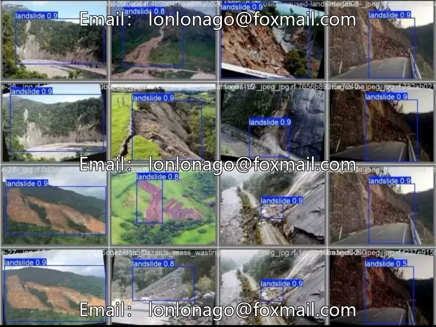
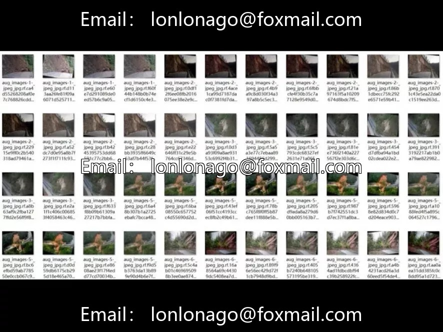
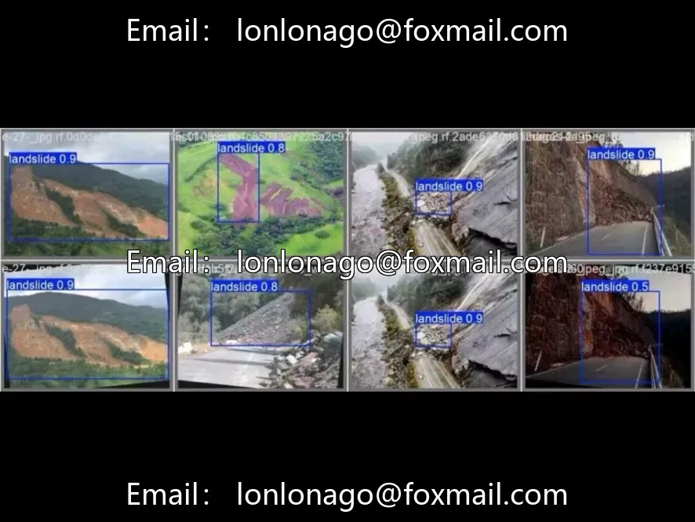

# Mountain landslide target detection dataset, a total of 4400 aerial/remote sensing images, YOLO

## Body

Mountain landslide target detection dataset, consisting of 4400 aerial/remote sensing images in YOLO format with single-class label "landslide", labeled bounding boxes of the landslide body. The scene focuses on typical mountain landslide areas, where the landslide bodies are irregularly shaped, with blurred edges, making detection challenging. The sample size is moderate, suitable for scenarios such as geological disaster monitoring, emergency response, and drone post-disaster inspections.

The data format is .jpg+.txt, and once the data.yaml file is properly configured, it can be directly trained without needing secondary cleaning. Normally, train, validate and test sets are divided according to the usual practice.

Virtual materials, once sold, are non-refundable.
Interested friends, click "I want" to proceed.

## Images

## Payment

Here is a pay link on Stripe ( https://buy.stripe.com/3cs8yP7sY87d0vu9AB ). Please contact me lonlonago@foxmail.com after funding $89, and I will send you a complete data files , thank you!

